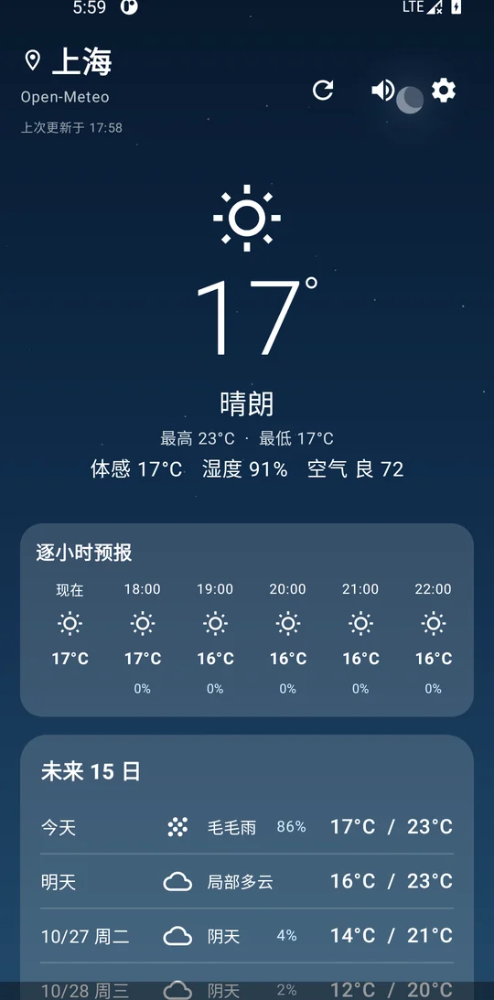
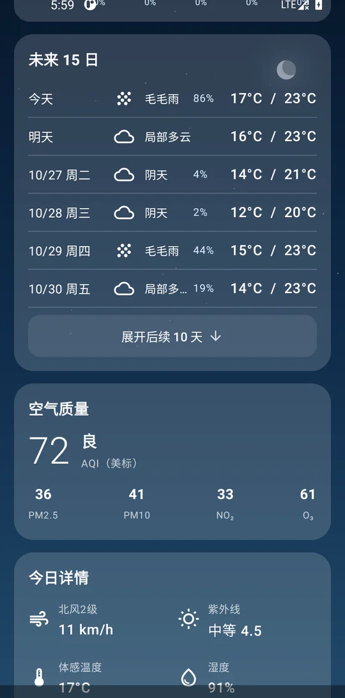
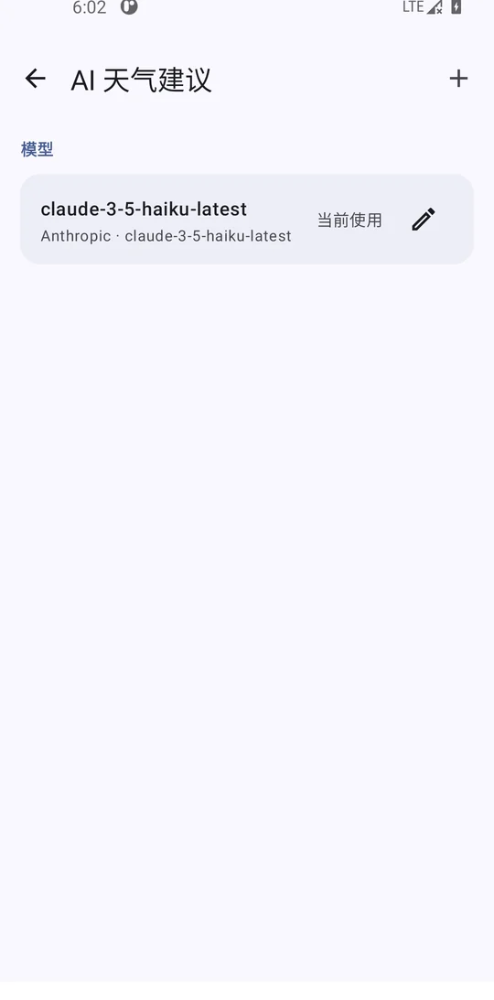
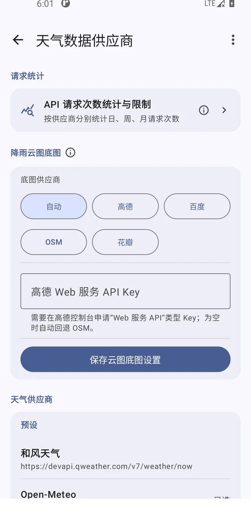
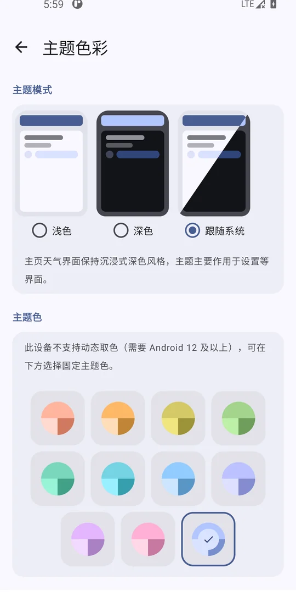
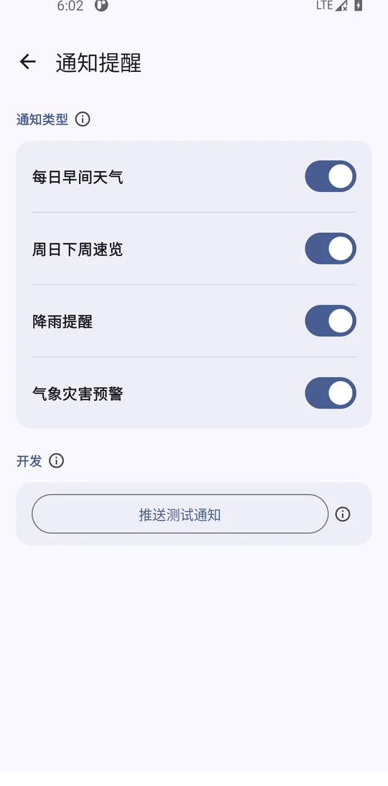
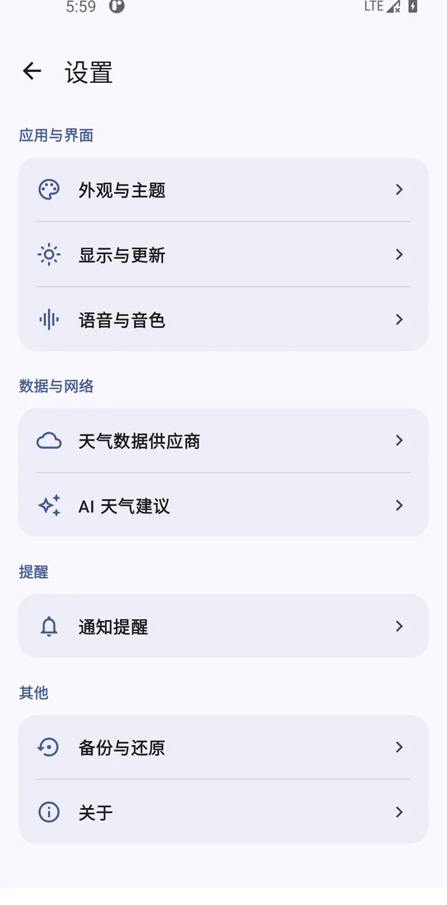

<p align="center">
  
</p>

<h1 align="center">NekoWeather <sub>猫猫風雨</sub></h1>

<p align="center">
  <b>天気データ・動く雨雲レーダー・AI アドバイス・Live2D キャラクターを 1 画面に収めたオープンソース Android 天気アプリ</b><br>
  <sub>Kotlin · Jetpack Compose · Material 3 &nbsp;|&nbsp; アカウント不要 · 広告なし · トラッキングなし</sub>
</p>

<p align="center">
  <a href="https://github.com/FatPanda8885/NekoWeather/releases"></a>
  
  
  
  
  <a href="https://github.com/FatPanda8885/NekoWeather/actions/workflows/ci.yml"></a>
</p>

<p align="center">
  <a href="README_zh-CN.md">简体中文</a> ·
  <a href="README_zh-TW.md">繁體中文</a> ·
  <b>日本語</b> ·
  <a href="README.md">English</a>
</p>

<p align="center">
  
  &nbsp;
  
  &nbsp;
  
</p>

---

## ✨ ひと目でわかる特徴

| 気になる点 | NekoWeather の答え |
| --- | --- |
| **プライバシー** | アカウント不要・広告なし・計測なし。設定・都市・API キーはすべて端末内に保存し、自前サーバーへの送信は一切なし |
| **情報量** | 1 画面に現在の天気＋24 時間＋15 日間＋空気質＋日の出/日の入り＋太陽高度の弧＋降水確率グラフ |
| **データ源の自由** | Open-Meteo はキー不要ですぐ使える／和風天気に切替可能／独自 endpoint + JSON パステンプレートで任意 API に接続 |
| **没入感** | Cubism SDK 5 による Live2D キャラクター：モーション・表情・物理・呼吸・まばたき・視線追従・タップ反応、さらにビジュアル配置エディタ |
| **カスタマイズ** | フォント差し替え／ロゴ／静止画・動画背景／天気別背景／ランチャーアイコン／オフライン VITS-Piper 音声モデル |
| **囲い込みなし** | 4 言語 UI、ZIP バックアップ、API 使用量の統計と上限、GitHub + Gitee の 2 経路配布 |

## 🚀 30 秒で開始

1. **インストール**：[GitHub Releases](https://github.com/FatPanda8885/NekoWeather/releases)（または [Gitee ミラー](https://gitee.com/pasky/NekoWeather/releases)）から ABI に合う APK を取得。
2. **起動**：初回は表示言語を選択 → 位置情報を許可（拒否しても都市の手動検索で利用可）。
3. **使う**：ホームを下に引いて更新。右上は **更新 / 読み上げ / 設定** の順。

> 既定のデータ源 Open-Meteo は **API キー不要**。インストール後すぐ動きます。

## 🎯 主な機能

### 🌤 1 画面で完結する天気ダッシュボード

現在の天気＋動く天気シーン（雲・雨・雪・日差し）· 24 時間の毎時予報（気温 / 降水確率 / 風）· 15 日間予報（最高最低・天気・日の出/日の入り）· 空気質（PM2.5 / PM10 / NO₂ / O₃ / SO₂、US & EU 両基準）· 風速風向・湿度・気圧・視程・UV · 操作できる太陽高度の弧と降水確率／雨量グラフ。


### 🗺 動く雨雲レーダーと警報カード

RainViewer のアニメーション降雨レイヤー。ベースマップは **OpenStreetMap / 高徳 / 花瓣地図（ファーウェイ）/ 百度** に切替可能で、「中国本土は高徳、それ以外は OSM」の自動モードも用意。危害警報カードは **自動（地域別に NWS / DWD）/ 和風 / 独自 GeoJSON·CAP / オフ** に対応。


### 🤖 AI 天気アドバイス

**Anthropic Messages API** 互換のサービスなら何でも接続可（Claude、DeepSeek、各種互換ゲートウェイ）。endpoint・モデル・システムプロンプト・出力長をすべて設定でき、回答はタイプライター演出＋ Markdown 表示。現在の天気・毎時／15 日予報・空気質・警報をコンテキストとして渡します。


### 🎭 Live2D キャラクター

**Cubism SDK for Java 5** のフル実装：ZIP で複数モデルを読み込み、ビジュアル配置エディタ（位置 / 拡大縮小 / 回転）。モーション・表情・物理・呼吸・まばたき・視線追従・タップ反応がすべて利用可能。

### 🌍 データ源と警報

| 種類 | 選択肢 |
| --- | --- |
| 天気データ | Open-Meteo（既定・キー不要）· 和風天気（要キー）· 独自 endpoint + JSON パス抽出 |
| 危害警報 | 自動（地域別 NWS / DWD）· 和風 · 独自 GeoJSON / CAP · オフ |



### 🎨 深いカスタマイズ

システムフォントの総入れ替え · ホームのロゴ · 静止画／動画背景 · 天気別（雷・雪・雨・霧・曇り・晴れ）の背景設定 · ランチャーショートカットのアイコン変更。



### 🔊 音声と TTS

システム TTS で天気を読み上げ。独自のオフライン **VITS / Piper ONNX** 音声モデルの読み込みにも対応。

### 📢 通知とリマインダー

毎朝の天気、日曜の週間予報、降水確率の通知、危害警報の通知。通知履歴つきで、再起動後も有効。



### 💾 バックアップ · 統計 · 複数都市

ZIP によるカテゴリ別バックアップ／復元（設定・都市・データ源・AI・音声モデル）· データ源／ドメイン別の API 呼び出し回数（日／週／月、上限設定可）· Open-Meteo の世界都市検索、GPS 取得、複数都市のスワイプ切替。



## 📦 ダウンロード

| 経路 | URL |
| --- | --- |
| **GitHub Releases** | <https://github.com/FatPanda8885/NekoWeather/releases> |
| **Gitee Releases**（中国本土ミラー） | <https://gitee.com/pasky/NekoWeather/releases> |

> ⚠️ 公式配布はこの **2 経路のみ** です。第三者のストア・ダウンロードサイト・フォーラムの APK は再パッケージされている可能性があり、安全性・正規性は保証しません。

## 🛠 ソースからビルド

| 依存 | バージョン |
| --- | --- |
| Android Studio | 最新安定版 |
| JDK | 17 |
| Android SDK | 35（compileSdk） |
| Kotlin | 2.1.20 |
| Gradle | 8.11（wrapper 同梱） |

```bash
git clone https://github.com/FatPanda8885/NekoWeather.git
cd NekoWeather

# 任意：Live2D Cubism SDK（無い場合は Live2D なしの lite ソースセットに自動フォールバックし、ビルドは通る）
# https://www.live2d.com/ から CubismSdkForJava-5-r.5.zip を取得し .cubism-sdk/ に展開

./gradlew assembleDebug     # 出力：app/build/outputs/apk/debug/
./gradlew assembleRelease   # signing/keystore.properties が必要
```

**動作要件**：Android 8.0（API 26）以上。ABI は arm64-v8a / x86 / x86_64（release は ABI 分割＋ユニバーサル APK）。

## 🏗 技術スタック

| 領域 | 採用 |
| --- | --- |
| 言語 / UI | Kotlin 2.1.20 · Jetpack Compose（Material 3） |
| アーキテクチャ | MVVM：ViewModel + StateFlow の単一状態源 |
| ネットワーク | OkHttp 4 |
| シリアライズ | 手書き JSON パース（`org.json`）＋ JSON パス抽出 |
| 保存 | SharedPreferences（`ConfigStore` / `WeatherCacheStore` など） |
| 描画 | Live2D Cubism SDK for Java 5（任意・条件付きコンパイル） |
| 難読化 | ProGuard（release） |

<details>
<summary>プロジェクト構成（クリックで展開）</summary>

```
app/src/main/java/com/neko/weather/
├── MainActivity.kt              # エントリポイント
├── model/Models.kt              # データモデル・列挙・DTO
├── data/                        # WeatherRepository / AlertRepository / AiAdviceRepository
│                                # CityRepository / ConfigStore / ApiUsageTracker
│                                # BackupManager / UpdateRepository
├── ui/                          # NekoWeatherApp（全画面）/ MainViewModel
│                                # Localization / Onboarding / LegalDocuments
├── notification/WeatherNotificationService.kt
└── tts/VoiceModelManager.kt
```

</details>

## ❓ FAQ

**アカウント登録は必要？** 不要です。アカウント機能自体がありません。

**データは収集されますか？** されません。天気を見るときに、**自分で設定した**データ源と AI エンドポイントへ要求を出すだけで、それ以外は端末内に留まります。詳しくは[プライバシーポリシー](app/src/main/assets/privacy_policy.md)。

**AI の API キーはどこに保存？** 端末内の SharedPreferences に平文で保存されます（設定画面に注意書きあり）。使わなければ設定不要で、機能は自動的に隠れます。

**Live2D Cubism SDK が無くてもビルドできる？** できます。無い場合は `lite` ソースセット（Live2D なし）に自動で切り替わり、エラーになりません。

**release に APK が複数ある理由は？** ABI ごとに分割（arm64-v8a / x86 / x86_64）してサイズを抑えるためで、ユニバーサル APK も同梱されています。

**天気データは正確？** 選んだデータ源に依存します。アプリ側での補正は行いません。データ源と公式警報を優先してください。

## 📜 ライセンスと法的文書

本プロジェクトは **GNU General Public License v3.0（GPLv3）** で公開されています。全文は [LICENSE](LICENSE)。

| 文書 | 内容 |
| --- | --- |
| [利用規約](app/src/main/assets/terms_of_use.md) | 免責・利用者の責任・第三者コンテンツ |
| [プライバシーポリシー](app/src/main/assets/privacy_policy.md) | データの取り扱い：個人情報を収集しません |
| [第三者表記](app/src/main/assets/third_party_notice.md) | 第三者コンポーネントのライセンスと謝辞 |

> ⚠️ **NekoWeather は「現状のまま」提供され、いかなる保証も伴いません。** 天気データの正確性、地図境界、AI 生成内容、第三者サービスについて開発者は責任を負いません。

## 🌐 公式サイト

<https://nekoweather.12am.moe>（準備中・現在利用不可）— 最新情報は本リポジトリを参照してください。

## 🤖 AI 利用の開示

本プロジェクトの開発では **OpenAI Codex** や **DeepSeek** などの AI / LLM ツールを、コード生成・翻訳・ドキュメント作成・ワークフロー支援に使用しています。AI の出力はすべて人間の開発者がレビューし検証しています。

## 🙏 謝辞

- [Open-Meteo](https://open-meteo.com/) — 無料の天気・空気質 API
- [RainViewer](https://www.rainviewer.com/) — 無料の降雨レーダー
- [OpenStreetMap](https://www.openstreetmap.org/) — 無料の地図データ
- [Jetpack Compose](https://developer.android.com/compose) — Android のモダン UI ツールキット
- [OkHttp](https://square.github.io/okhttp/) — HTTP クライアント
- [Live2D Cubism SDK](https://www.live2d.com/) — キャラクターアニメーションランタイム

完全なリストは[第三者表記](app/src/main/assets/third_party_notice.md)を参照。

---

<p align="center">
  <sub>Made with ❤️ · <a href="https://github.com/FatPanda8885/NekoWeather">GitHub</a> · <a href="https://gitee.com/pasky/NekoWeather">Gitee</a></sub>
</p>
